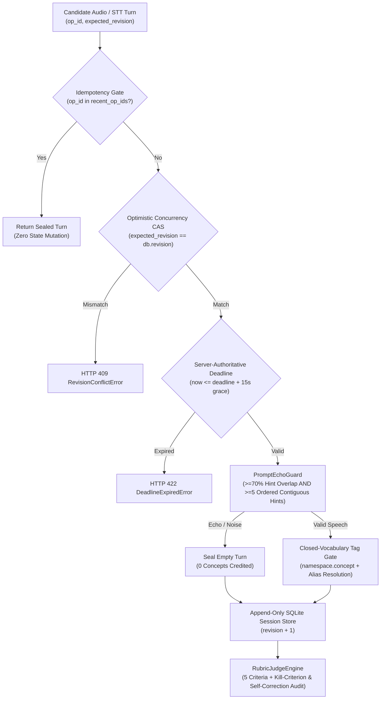

# Stateful Voice AI Examiner & Evaluation Guardrail Harness

[](https://github.com/tncyavci/voice-agent-eval-guardrail-harness/actions/workflows/ci.yml)
[](https://www.python.org/)
[](https://fastapi.tiangolo.com/)
[](LICENSE)

**A production-grade multi-turn Voice AI assessment state machine, Speech-to-Text (STT) Prompt-Echo Hallucination Guardrail, Closed-Vocabulary Concept Taxonomy Validator, and Non-Compensatory LLM-as-a-Judge Calibration Harness built with Python, FastAPI, SQLite, and Pydantic v2.**

Designed for high-stakes voice/conversational AI platforms (technical certification simulators, clinical/safety oral examinations, and automated structured interviews) where three failure modes routinely break naive LLM pipelines:

1. **STT Prompt-Echo Hallucinations on Silence/Noise:** Speech-to-Text models (`gpt-4o-transcribe`, `whisper-1`) given a domain vocabulary hint list frequently recite the prompt hints verbatim at high log-probability when fed 2–4 seconds of silence or background noise. Probability-only confidence filters misclassify this echo as fluent domain speech.
2. **Concurrent Turn Races & Network Retries:** Mobile/browser voice recorders retry failed uploads or double-submit turns on flaky networks, corrupting multi-phase state machines without Compare-And-Swap (`revision` CAS) and `op_id` idempotency.
3. **Compensatory Grading of Unsafe Actions:** Standard weighted rubric averages allow a candidate who commits a critical safety violation to pass if their communication fluency score is high.

---

## System Architecture



---

## Key Engineering Highlights

- **Dual-Invariant STT Prompt-Echo Detector (`PromptEchoGuard`):** Flags a transcript as `REJECTED_PROMPT_ECHO` if and only if **both** token overlap against the hint vocabulary is $\ge 70\%$ **and** at least $5$ hint terms appear consecutively in the exact prompt order. Legitimate candidate responses that use multiple domain terms in natural prose are never falsely penalized.
- **Optimistic Concurrency (`revision` CAS) & Idempotent Turn Replay (`OralSessionStore`):** Every session state transition is guarded by an atomic SQLite `WHERE session_id = ? AND revision = ?` check and a 32-slot `recent_op_ids` ring buffer.
- **Closed-Vocabulary Taxonomy (`namespace.concept`):** Untrusted LLM concept extractions are normalized through deterministic alias mapping and validated against a strict closed vocabulary (`safety.lockout_tagout_verification`, `incident.root_cause_isolation`, etc.), returning `None` on hallucinated tags.
- **Non-Compensatory Rubric & Self-Correction Audit (`RubricJudgeEngine`):** Implements a 5-criterion (25-point) station evaluator with kill criteria (`communicative_effectiveness == 0` or uncorrected `UNSAFE` action zeroes the station) while distinguishing candidate self-correction (`PROVISIONAL_PASS_PENDING_SAFETY_REVIEW` with `hold_for_manual_review=True`).

---

## Quickstart & Testing

```bash
pip install -e ".[dev]"
pytest -v
uvicorn app:app --reload --port 8000
```
